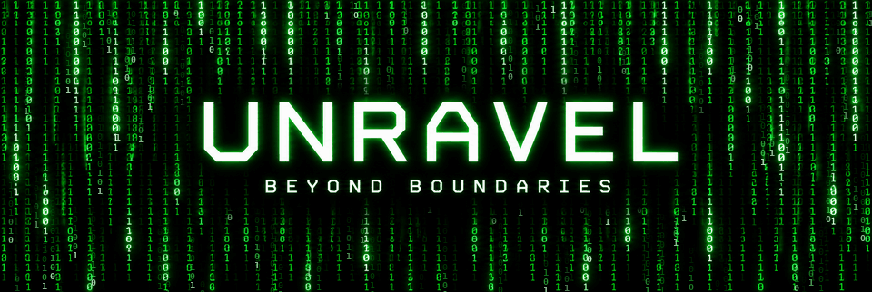

<div align="center">



<p><strong>A personal blog and project portfolio.</strong></p>
<p>Projects show what I build. Writing records what I learn and why.</p>

<p>
  <a href="https://unraveltao.github.io/">Visit the site</a> ·
  <a href="https://unraveltao.github.io/posts/">Read the blog</a> ·
  <a href="https://unraveltao.github.io/projects/">Explore projects</a> ·
  <a href="docs/README.zh-CN.md">简体中文</a>
</p>

</div>

## Explore

### Writing

The archive contains essays, project notes, technical decisions, and reflections from practice. One article is currently published:

- [Hello World](https://unraveltao.github.io/posts/hello-world/) — a return to programming and blogging, and a reflection on how AI changed the author's approach to making things. *(Thinking)*

Browse writing by its four registered categories in [Personal OS](https://unraveltao.github.io/personal-os/):

| Category | Entry |
|---|---|
| Thinking | [Ideas and perspectives](https://unraveltao.github.io/personal-os/thinking/) |
| Review | [Practice and reflection](https://unraveltao.github.io/personal-os/review/) |
| Skill | [Reusable methods](https://unraveltao.github.io/personal-os/skill/) |
| Log | [Project and learning notes](https://unraveltao.github.io/personal-os/log/) |

Categories are editorial entry points; tags describe topics. The category pages are available even when they have no published articles yet.

### Projects

- [Computer Science Atlas](https://unraveltao.github.io/projects/computer-science-atlas/) · [Source](https://github.com/unraveltao/Computer-Science-Atlas) — a growing, linked map of computer science topics.
- [Lattice](https://unraveltao.github.io/projects/lattice/) · [Source](https://github.com/unraveltao/Lattice) — a Windows desktop platform for web widgets, plugins, permissions, and agent workflows.
- [Skills](https://unraveltao.github.io/projects/skills/) · [Source](https://github.com/unraveltao/Skills) — independently installable Agent Skills for learning, research, engineering, and repeatable tasks.

## Tech Stack

| Area | Technology |
|---|---|
| UI | React 19, React Router 7 |
| Build | Vite 8, TypeScript 6 |
| Content | Velite 0.4, Markdown and legacy MDX |
| Hosting | GitHub Pages; Vercel branch previews |

Posts are stored in `content/posts/<slug>/index.md` and use YAML frontmatter. Existing Post `.mdx` files remain supported. Project pages are authored as `.mdx`. Velite validates content and generates the static pages.

## Quick Start

Requirements: Node.js 22 and pnpm 9.

```bash
pnpm install
pnpm dev
```

Open <http://localhost:5173/>. To verify and preview a production build:

```bash
pnpm test
pnpm build
pnpm preview
```

## Documentation

- [Project documentation index](docs/00-Project-Overview.md)
- [Repository instructions](AGENTS.md)
- [Product requirements](docs/02-Product-Requirements.md)
- [Design system](docs/03-Design-System.md)
- [Technical architecture](docs/04-Technical-Architecture.md)
- [Decision log](docs/06-Decision-Log.md)
- [中文说明](docs/README.zh-CN.md)

<details>
<summary>Maintenance and deployment</summary>

GitHub Actions runs `pnpm test` and `pnpm build` for pull requests and pushes to `main`. A push to `main` also builds and deploys the static site to GitHub Pages. Vercel provides preview deployments for branch and pull request review.

This is a personally maintained website. The repository is public for transparency and reference, but it does not accept code contributions and is not a supported starter template.

</details>
